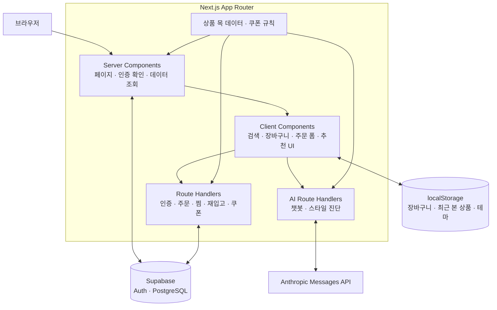

<div align="center">

# MyShop

### 상품 탐색부터 AI 추천, 장바구니와 주문까지 연결하는 패션 쇼핑몰

Next.js 기반 쇼핑 흐름에 상품 데이터 기반 챗봇과 스타일 진단을 더한 풀스택 포트폴리오입니다.


[주요 기능](#features) · [아키텍처](#architecture) · [설계 포인트](#design) · [실행 방법](#getting-started) · [검증](#verification) · [상세 문서](#documents)

</div>

> 문서 갱신: **2026-10-20** · 코드 기준: **`483c416` (2026-06-15)**<br/>
> 저장소: **VibeCodingUsingAI** · 패키지: **`study` / `0.1.0`** · 개발: **정성윤**

<a id="overview"></a>
## 프로젝트 소개

상품 검색·상세·장바구니·주문 내역으로 이어지는 쇼핑 흐름을 구현하고, AI가 상품 선택을 돕도록 구성했습니다. 프론트엔드 상호작용뿐 아니라 인증, 서버의 주문 금액 계산, 사용자별 데이터 저장까지 연결하는 프로젝트입니다.

상품과 쿠폰은 코드에 정의한 데모 데이터를 사용하고, 회원·주문·찜·재입고 신청은 Supabase와 연동합니다. **주문 생성·조회까지 구현했으며, 실제 결제 승인과 재입고 메시지 발송은 포함하지 않습니다.**

```text
상품 탐색 → 상세·사이즈 선택 → 장바구니 → 쿠폰·배송지 입력 → 주문 저장·조회
    └→ AI 챗봇 / 4문항 스타일 진단 → 추천 상품 확인
```

<a id="features"></a>
## 주요 기능

| 영역 | 구현 내용 |
| --- | --- |
| 상품 탐색 | 검색어와 카테고리를 URL에 반영하고 두 조건으로 함께 필터링 |
| 상품 상세 | 이미지 갤러리, 사이즈·실측 정보, 수량 선택, 재고 표시, 관련 상품 |
| 장바구니 | 상품·사이즈별 항목 관리, 수량 변경·삭제, 브라우저 저장소 유지, 무료배송 안내 |
| 인증 | Supabase 이메일·비밀번호 로그인, 회원가입 후 로그인, 보호 페이지 접근 제어 |
| 주문 | 배송지 입력, 서버의 상품 금액·배송비·쿠폰 할인 재계산, 주문 목록·상세 조회 |
| 쿠폰 | 정액·정률 할인, 최소 주문 금액·최대 할인 한도, 사용 가능한 쿠폰 안내·코드 복사 |
| 찜·재입고 신청 | 로그인 사용자의 찜 추가·삭제, 재입고 알림 신청·조회·취소 |
| 최근 본 상품·공유 | 최근 본 상품 최대 6개 저장, Web Share API 또는 링크 복사 |
| AI 쇼핑 도우미 | 상품 정보를 포함한 대화 요청, 응답의 상품 ID를 실제 상품 카드로 연결 |
| AI 스타일 진단 | 착용 상황·핏·분위기·색감 4문항으로 스타일 유형·코디·상품 추천 |
| 화면 구성 | 다크모드·시스템 테마, 모바일 메뉴, 토스트, 로딩·오류 화면, 맨 위로 이동 |

### 최신 반영 내용

- **쿠폰 안내**: 장바구니와 주문 화면에서 할인 조건·예상 할인액·쿠폰 코드를 확인합니다.
- **쿠폰 적용**: 화면의 할인 미리보기와 별도로, 주문 API에서 쿠폰과 금액을 다시 계산합니다.
- **상품 공유**: 브라우저의 공유 기능을 사용하고, 지원하지 않으면 상품 링크를 복사합니다.
- **다크모드**: 테마 선택을 저장하고 시스템 설정을 반영합니다.

<a id="architecture"></a>
## 아키텍처



### 기술 스택

| 구분 | 기술 | 사용 위치 |
| --- | --- | --- |
| 프레임워크 | Next.js 16.2.6, React 19.2.4 | App Router, Server / Client Components, Route Handlers |
| 언어 | TypeScript 5 | 상품·주문·스타일·쿠폰 타입과 컴포넌트 |
| 스타일 | Tailwind CSS 4, next-themes | 반응형 화면과 테마 전환 |
| 상태 관리 | Zustand 5, persist | 장바구니 상태와 브라우저 저장 |
| 인증·DB | Supabase Auth, PostgreSQL, `@supabase/ssr` | 쿠키 기반 세션과 사용자 데이터 |
| AI | Anthropic Claude API | 서버에서 상품 문맥을 포함한 추천 요청 |
| 실행·배포 구성 | Docker, Next.js standalone | 멀티스테이지 이미지와 Compose 실행 |
| 정적 검사 | ESLint 9, TypeScript | 코드 규칙과 타입 검사 |

<a id="design"></a>
## 주요 설계 포인트

### 1. 서버의 데이터 처리와 화면 상호작용 분리

페이지·인증 확인·주문 조회는 Server Component에서 처리하고, 검색·장바구니·폼·테마처럼 상호작용이 필요한 부분을 Client Component로 나눴습니다.

상품 검색은 `q`, 카테고리는 `cat` 쿼리로 관리합니다. 같은 URL을 다시 열어도 검색 조건을 재현할 수 있으며, 현재 상품 필터링은 전달받은 목 데이터에 대해 클라이언트에서 수행합니다.

### 2. 브라우저 저장 상태와 초기 렌더링 구분

장바구니는 Zustand `persist`로 `localStorage`에 저장합니다. 상품 ID와 선택한 사이즈를 함께 사용해 같은 상품의 다른 사이즈를 구분합니다.

헤더의 장바구니 수량 배지는 마운트 후 표시해 서버의 초기 값과 브라우저에 저장된 값이 다른 상황을 처리합니다. 최근 본 상품도 브라우저 저장소에서 복원하고 최대 6개로 유지합니다.

관련 코드: [장바구니 스토어](src/store/cartStore.ts) · [수량 배지](src/components/features/layout/CartIcon.tsx) · [최근 본 상품](src/hooks/useRecentlyViewed.ts)

### 3. 주문 금액을 서버에서 다시 계산

주문 API는 클라이언트가 보낸 상품 가격·할인액을 그대로 저장하지 않습니다. 상품 ID로 서버의 상품 데이터를 찾고 수량을 적용한 뒤, 배송비와 쿠폰을 계산합니다.

```text
상품 합계 = 서버 상품 단가 × 요청 수량의 합
배송비 = 할인 전 상품 합계가 50,000원 이상이면 0원, 미만이면 3,000원
주문 상품 금액 = max(상품 합계 - 쿠폰 할인, 0)
화면의 최종 합계 = 주문 상품 금액 + 배송비
```

`orders.total_price`에는 할인 후 상품 금액을, `shipping_fee`에는 배송비를 별도로 저장합니다. `order_items`에는 서버에서 조회한 상품명·단가·이미지와 주문 수량을 저장합니다. 쿠폰이 주문 시점에 유효하지 않으면 현재 구현은 할인 없이 주문을 진행합니다.

관련 코드: [주문 API](app/api/orders/route.ts) · [쿠폰 계산](src/lib/coupons.ts)

### 4. AI 응답을 상품 데이터와 연결

AI 요청에는 상품 ID·이름·가격·카테고리 등의 정보를 함께 전달합니다. 모델의 응답에서 추천 ID를 읽은 뒤, 코드의 상품 목록에 존재하고 재고가 있는 상품만 카드 데이터로 반환합니다.

- 챗봇: 대화 메시지와 추천 상품을 함께 응답하며, JSON 파싱 실패 시 텍스트만 반환합니다.
- 스타일 진단: 4개 설문 답변으로 스타일 유형·설명·키워드·코디·팁과 추천 상품을 생성합니다.
- API 키: 서버 Route Handler에서 `ANTHROPIC_API_KEY`를 사용합니다.
- 코드에 지정된 모델: `claude-haiku-4-5-20251001`

별도 벡터 DB나 검색 인덱스를 사용하는 구조는 아니며, 현재 상품 목록을 요청 문맥에 포함하는 방식입니다.

관련 코드: [챗봇 API](app/api/chat/route.ts) · [스타일 진단 API](app/api/style-quiz/route.ts)

### 5. 인증과 데이터 접근 경계

`proxy.ts`에서 세션을 갱신하고 `/cart`, `/checkout`, `/orders`, `/mypage`의 미로그인 접근을 로그인 화면으로 보냅니다. 주문·찜·재입고 API도 별도로 사용자를 확인합니다.

회원가입은 서버의 Admin API로 이메일 확인 상태의 계정을 생성합니다. 주문 생성도 서버의 service role 클라이언트를 사용하므로, 일반 사용자 세션의 DB 접근과 구분됩니다. 사용자별 주문 조회 권한은 Supabase의 RLS 정책을 올바르게 설정해야 보장됩니다.

관련 코드: [페이지 접근 제어](proxy.ts) · [회원가입 API](app/api/auth/signup/route.ts)

<a id="data"></a>
## 데이터 구성과 구현 범위

| 데이터 | 저장·관리 방식 | 용도 |
| --- | --- | --- |
| 상품 | `src/lib/mock-data.ts` | 목록·상세·가격·재고·AI 추천의 기준 |
| 쿠폰 | `src/lib/coupons.ts` | 할인 코드·조건·계산 규칙 |
| 장바구니 | 브라우저 `localStorage` | 상품·수량·선택 사이즈 유지 |
| 최근 본 상품 | 브라우저 `localStorage` | 최근 상품 ID 최대 6개 |
| 회원·세션 | Supabase Auth | 회원가입·로그인·세션 갱신 |
| 주문·주문 상품 | `orders`, `order_items` | 배송지·금액·주문 당시 상품 정보 |
| 찜·재입고 신청 | `wishlists`, `restock_alerts` | 사용자와 상품의 연결 정보 |

### 데모 쿠폰

| 코드 | 할인 | 최소 상품 금액 | 최대 할인 |
| --- | --- | --- | --- |
| `WELCOME10` | 10% | 20,000원 | 5,000원 |
| `SAVE5000` | 5,000원 | 50,000원 | 5,000원 |
| `WEEKEND15` | 15% | 30,000원 | 10,000원 |

코드는 대소문자를 구분하지 않습니다. 현재는 코드와 금액 조건을 검증하는 데모이며, 이름에 포함된 신규 가입·주말 조건이나 사용자별 사용 횟수를 검사하지 않습니다.

<details>
<summary><strong>현재 범위와 향후 확장 항목</strong></summary>

- 실제 PG 결제 승인·취소·환불 연동
- 상품·재고·쿠폰의 DB 관리와 재고 차감
- 재입고 신청을 기반으로 한 이메일·메시지 발송
- 주문과 주문 상품 저장의 트랜잭션 처리, 요청 검증 강화
- DB 스키마·RLS 정책을 재현할 수 있는 마이그레이션
- 단위·통합·E2E 테스트와 CI 자동화

위 항목은 현재 완료 기능과 구분한 확장 범위입니다.

</details>

<a id="getting-started"></a>
## 로컬 실행

### 준비 사항

- **Node.js 20.9 이상**, npm — 잠금 파일의 Next.js 엔진 요구사항 기준
- **Supabase 프로젝트** — Auth와 아래 데이터 테이블 준비
- **Anthropic API 키** — 챗봇·스타일 진단을 사용할 때 필요
- **Docker / Compose** — 컨테이너로 실행할 경우 필요

### 1. 저장소와 의존성 준비

```bash
git clone https://github.com/dkffprtm0404-rgb/VibeCodingUsingAI.git
cd VibeCodingUsingAI
npm ci
```

이미 로컬 `study` 폴더를 사용 중이라면 해당 폴더에서 실행합니다.

### 2. 환경변수 설정

저장소 루트에 `.env.local`을 직접 만들고 다음 값을 설정합니다. 현재 저장소에는 복사해서 사용할 `.env.example` 파일이 없습니다.

```dotenv
NEXT_PUBLIC_SUPABASE_URL=https://YOUR_PROJECT.supabase.co
NEXT_PUBLIC_SUPABASE_ANON_KEY=YOUR_SUPABASE_ANON_KEY
SUPABASE_SERVICE_ROLE_KEY=YOUR_SUPABASE_SERVICE_ROLE_KEY
ANTHROPIC_API_KEY=YOUR_ANTHROPIC_API_KEY

# 선택 설정
NEXT_PUBLIC_APP_URL=http://localhost:3000
NEXT_PUBLIC_APP_NAME=MyShop
```

| 변수 | 사용 범위 |
| --- | --- |
| `NEXT_PUBLIC_SUPABASE_URL` | 서버·브라우저의 Supabase 연결 주소 |
| `NEXT_PUBLIC_SUPABASE_ANON_KEY` | 사용자 세션 기반 Supabase 접근 |
| `SUPABASE_SERVICE_ROLE_KEY` | 서버의 회원가입·주문 생성 전용 |
| `ANTHROPIC_API_KEY` | 서버의 챗봇·스타일 진단 호출 전용 |
| `NEXT_PUBLIC_APP_URL`, `NEXT_PUBLIC_APP_NAME` | 앱 공통 상수의 선택 설정 |

서버 전용 키에는 `NEXT_PUBLIC_` 접두사를 붙이지 않습니다. `.env.local`은 Git 제외 대상입니다.

### 3. Supabase 데이터 준비

이 저장소에는 테이블·정책을 생성하는 SQL 마이그레이션이 포함되어 있지 않습니다. Supabase 쪽에 코드와 맞는 스키마 및 RLS 정책을 준비해야 주문·찜·재입고 기능을 사용할 수 있습니다.

| 테이블 | 코드가 사용하는 주요 필드·관계 |
| --- | --- |
| `orders` | `id`, `user_id`, `status`, `total_price`, `shipping_fee`, `receiver_name`, `receiver_phone`, `receiver_address`, `receiver_address_detail`, `memo`, `created_at` |
| `order_items` | `id`, `order_id`, `product_id`, `product_name`, `product_price`, `product_image`, `quantity`; 주문과의 관계 |
| `wishlists` | `user_id`, `product_id` |
| `restock_alerts` | `user_id`, `product_id` |

`orders`와 `order_items`의 관계 조회, 주문 ID·상태·생성 시각의 기본값, 로그인 사용자의 본인 데이터 접근 정책을 확인합니다. 상품 ID는 현재 코드의 목 데이터 ID를 사용합니다. 타입과 저장 형식은 [주문 타입](src/types/order.ts), [주문 API](app/api/orders/route.ts), [찜 API](app/api/wishlist/route.ts), [재입고 신청 API](app/api/restock/route.ts)를 기준으로 확인하세요.

### 4. 개발 서버 실행

```bash
npm run dev
```

[http://localhost:3000](http://localhost:3000)에 접속합니다. AI 키가 없으면 챗봇·스타일 진단 요청은 설정 오류를 반환합니다.

프로덕션 빌드와 실행:

```bash
npm run build
npm run start
```

<a id="docker"></a>
## Docker 실행

`.env.local`과 Supabase 준비를 마친 후 저장소 루트에서 실행합니다.

```bash
docker compose --env-file .env.local up --build -d
docker compose --env-file .env.local logs -f myshop
```

[http://localhost](http://localhost)에 접속합니다. Compose는 호스트의 `80` 포트를 컨테이너의 `3000` 포트로 연결합니다.

- `Dockerfile`: Node 20 Alpine 기반 멀티스테이지 구성, standalone 결과물 실행, 비루트 사용자
- 빌드 시점: Compose의 `build.args`로 `NEXT_PUBLIC_*` 값을 전달
- 실행 시점: `env_file: .env.local`로 서버 환경변수 전달
- `--env-file .env.local`: Compose가 빌드 인자에 사용할 값도 같은 파일에서 읽도록 지정

공개 환경변수를 변경하면 이미 만들어진 브라우저 번들에 반영되도록 다시 빌드해야 합니다.

중지:

```bash
docker compose --env-file .env.local down
```

<a id="routes"></a>
## 주요 페이지와 API

| 페이지 | 역할 |
| --- | --- |
| `/`, `/products` | 홈·상품 검색·카테고리 필터 |
| `/products/[id]` | 상세·사이즈·공유·찜·재입고 신청 |
| `/cart`, `/checkout` | 장바구니·쿠폰·배송지·주문 |
| `/orders`, `/orders/[id]` | 주문 목록·상세 |
| `/mypage/wishlist` | 찜 목록 |
| `/style-quiz` | AI 스타일 진단 |
| `/login`, `/signup` | 로그인·회원가입 |
| `/portfolio` | 프로젝트 소개 화면 |

| API | 역할 |
| --- | --- |
| `POST /api/auth/signup` | 회원가입·자동 로그인 시도 |
| `POST /api/auth/login`, `POST /api/auth/logout` | 로그인·로그아웃 |
| `GET /api/orders`, `POST /api/orders` | 주문 목록·생성 |
| `GET /api/wishlist`, `POST /api/wishlist`, `DELETE /api/wishlist` | 찜 조회·추가·삭제 |
| `GET /api/restock`, `POST /api/restock`, `DELETE /api/restock` | 재입고 신청 조회·추가·취소 |
| `POST /api/coupon` | 쿠폰 코드와 금액 조건 확인 |
| `POST /api/chat` | 상품 기반 AI 대화 |
| `POST /api/style-quiz` | 스타일 분석·추천 |

주문 상세는 Server Component에서 Supabase를 조회합니다. 별도의 `/api/orders/[id]` Route Handler는 없습니다.

<a id="verification"></a>
## 검증

현재 제공하는 검사·빌드 명령입니다. `npm ci`와 환경 설정 후 실행합니다.

```bash
npm run lint
npx tsc --noEmit --incremental false
npm run build
```

`package.json`에는 `test` 스크립트가 없으며, 자동화 테스트와 CI 설정은 아직 포함되어 있지 않습니다. 빌드는 Supabase 환경 설정과 Google 폰트 다운로드 등 외부 접근의 영향을 받을 수 있습니다.

### 기능 확인 체크리스트

- [ ] 검색어·카테고리 URL을 다시 열었을 때 같은 조건으로 상품이 표시되는가
- [ ] 상품·사이즈별 장바구니 항목과 새로고침 후 수량이 유지되는가
- [ ] 쿠폰 최소 금액·할인 한도·배송비와 주문 저장 금액이 일치하는가
- [ ] 미로그인 상태에서 보호 페이지와 인증이 필요한 API 접근이 제한되는가
- [ ] Supabase 정책이 다른 사용자의 주문·찜·재입고 데이터 접근을 막는가
- [ ] 공유·최근 본 상품·테마 전환이 동작하는가
- [ ] 챗봇·스타일 진단의 추천 카드가 현재 상품과 연결되는가

체크리스트는 검증 절차이며 자동 테스트 통과 기록을 의미하지 않습니다. 회원가입·주문 확인은 별도 테스트용 Supabase 환경에서, AI 기능 확인은 본인의 API 사용 설정을 확인한 뒤 진행합니다.

<a id="structure"></a>
## 프로젝트 구조

```text
app/                         # App Router (저장소 루트)
├── api/                     # 인증·주문·찜·재입고·쿠폰·AI API
├── products/[id]/           # 상품 목록·상세
├── cart/                    # 장바구니
├── checkout/                # 주문 작성
├── orders/[id]/             # 주문 목록·상세
├── mypage/wishlist/         # 찜 목록
├── style-quiz/              # 스타일 진단
├── login/ · signup/         # 인증 화면
└── portfolio/               # 프로젝트 소개

src/
├── components/
│   ├── features/            # auth·cart·chat·layout·order·product·style
│   └── ui/                  # 버튼·테마·토스트·빈 상태 등 공통 UI
├── hooks/                   # 인증·쿠폰·찜·재입고·최근 본 상품
├── lib/
│   ├── supabase/            # 서버·브라우저 클라이언트
│   ├── api.ts               # 클라이언트 API 호출 공통 처리
│   ├── mock-data.ts         # 상품 데이터
│   └── coupons.ts           # 쿠폰 데이터·계산
├── store/cartStore.ts       # 장바구니 상태
├── constants/               # 앱·배송·API 경로 상수
└── types/                   # 상품·주문·스타일·쿠폰 타입

proxy.ts                     # 세션 갱신·보호 페이지 접근 제어
Dockerfile                   # standalone 멀티스테이지 빌드
docker-compose.yml           # 컨테이너 실행 설정
docs/                        # 아키텍처·컨벤션·개발 절차
```

<a id="documents"></a>
## 상세 문서

| 주제 | 문서 |
| --- | --- |
| 구조·렌더링 전략 | [아키텍처](docs/ARCHITECTURE.md) |
| 코딩 규칙 | [컨벤션](docs/CONVENTIONS.md) · [금지 패턴과 개선 기록](docs/DO_NOT.md) |
| Docker 구성 | [Docker 안내](docs/DOCKER.md) |
| 협업·Git | [Git 작업 흐름](docs/GIT_WORKFLOW.md) |
| AI 협업 | [공통 작업 규칙](AGENTS.md) · [계획](AGENT_PLANNER.md) · [실행](AGENT_EXECUTOR.md) · [검토](AGENT_REVIEWER.md) |
| 검토 기준 | [품질 평가 기준](docs/QUALITY_SCORE.md) |

AI 협업은 계획 → 실행 → 검토 단계로 나누고, 변경 범위와 확인 근거를 남기는 방식으로 진행합니다. 이 README의 기능·경로·실행 안내는 상단의 코드 기준으로 갱신했으며, 세부 문서의 과거 기록과 구분해 읽을 수 있도록 구성했습니다.
